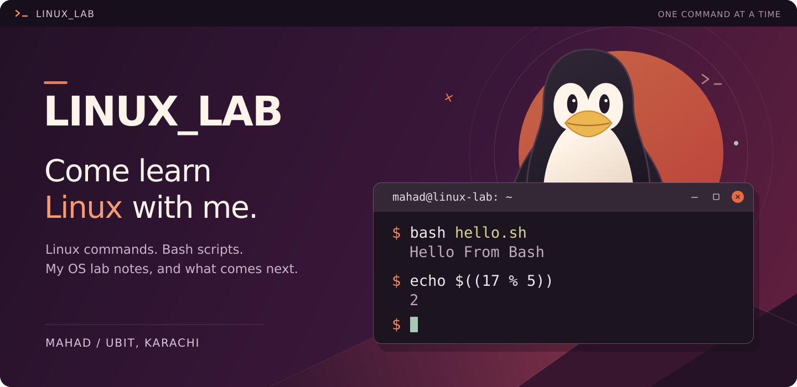
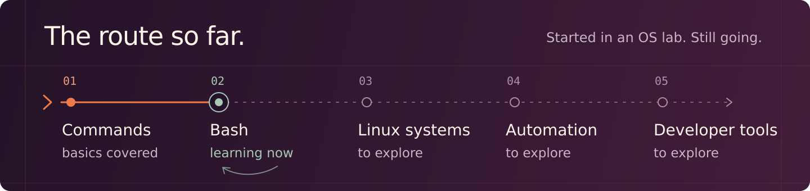
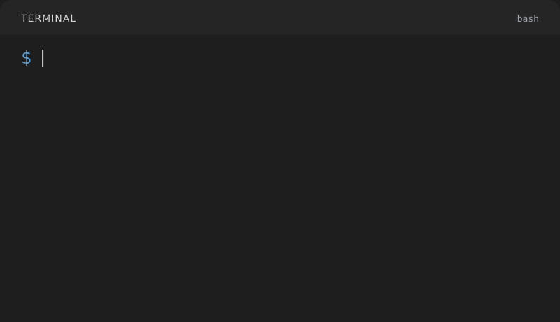

<div align="center">

<picture>
  <source media="(max-width: 600px)" srcset="assets/linux-lab-hero-mobile.svg">
  
</picture>

**Linux commands, Bash scripts, and the things I'll learn along the way.**

[Learning map](#what-im-learning) · [Course project](#course-project-deploylatch) · [Try a script](#lets-run-something) · [Setup guide](docs/GETTING_STARTED.md)

</div>

# LINUX_LAB

## Hey, I'm Shaikh Mahad 👋

I'm a **BS Software Engineering student at UBIT, University of Karachi**. I started this repo while learning Linux commands and Bash scripting for my **Operating Systems lab**. It holds my notes, example scripts, and exercises for practice and revision.

I want to keep going after the course and build scripts that help with everyday work. **If you're taking an OS course or just curious about Linux, come learn with me.** You can start from zero.

> **Current Bash topic:** [Bash 04: Operators and Expressions](learning/bash-scripting/04-operators-and-expressions/README.md)
>
> **At a glance:** 8 Linux command chapters · 4 Bash chapters · 15 example scripts.

> **New to Linux? [Start here: terminal and editor setup →](docs/GETTING_STARTED.md)**
> Follow the Ubuntu setup steps, install Git, and get your workspace ready for the examples below.

## Course project: DeployLatch

For my final **Operating Systems course project**, I built **[DeployLatch](https://github.com/codewithmahad/deploylatch)**, a Bash tool that deploys a Java service on Ubuntu, checks its health and version, and attempts to restore the previous working release if an update fails.

It connects the file paths, permissions, Bash, and exit statuses practised here to my Java backend work. It also took me into symbolic links, systemd services, and deployment locking—topics I'm still building towards in these notes.

[See the deployment demo](https://github.com/codewithmahad/deploylatch#deployment-demo) · [Read the deployment script](https://github.com/codewithmahad/deploylatch/blob/main/scripts/deploylatch.sh)

## What I'm learning



The route I have in mind is **commands → Bash → Linux systems → automation → developer tools**. I'll add explanations and examples as I study and practise them. The later topics below are plans; the linked chapters are the notes you can use today.

**First time here?** Start with [Navigation and Paths](learning/linux-commands/01-navigation-and-paths/README.md). Already comfortable moving around the terminal? Try [Shell and Script Basics](learning/bash-scripting/01-shell-and-script-basics/README.md).

<details>
<summary><strong>📂 Linux commands · 8 chapters available</strong></summary>

| Chapter | What's inside |
| :--- | :--- |
| **01 · [Navigation and paths](learning/linux-commands/01-navigation-and-paths/README.md)** | `pwd`, `ls`, `cd`, paths, hidden files, quoting names, and a [guided practice route](learning/linux-commands/01-navigation-and-paths/README.md#take-a-short-trip-through-the-repo). |
| **02 · [Files and directories](learning/linux-commands/02-files-and-directories/README.md)** | `mkdir`, `touch`, `file`, `stat`, `tree`, timestamps, and a [tiny project to build](learning/linux-commands/02-files-and-directories/README.md#your-turn-build-a-tiny-project). |
| **03 · [Viewing file content](learning/linux-commands/03-viewing-file-content/README.md)** | `cat`, `head`, `tail`, `less`, `more`, sample files, and a [live log experiment](learning/linux-commands/03-viewing-file-content/README.md#watch-a-file-grow). |
| **04 · [Copying, moving, and deleting](learning/linux-commands/04-copying-moving-and-deleting/README.md)** | `cp`, `mv`, `rm`, `rmdir`, destination paths, overwrite prompts, and a [lab session to pack up](learning/linux-commands/04-copying-moving-and-deleting/README.md#your-turn-pack-up-a-lab-session). |
| **05 · [Searching and finding](learning/linux-commands/05-searching-and-finding/README.md)** | `grep`, `find`, patterns, file searches, and a [folder of clues to investigate](learning/linux-commands/05-searching-and-finding/README.md#your-turn-follow-the-clues). |
| **06 · [Text processing](learning/linux-commands/06-text-processing/README.md)** | `wc`, `cut`, `sort`, `uniq`, `tr`, `sed`, `awk`, and a [small study report](learning/linux-commands/06-text-processing/README.md#your-turn-make-a-small-study-report). |
| **07 · [Redirection and pipes](learning/linux-commands/07-redirection-and-pipes/README.md)** | Input, output, errors, `>`, `>>`, `<`, pipes, `tee`, and a [review report to save](learning/linux-commands/07-redirection-and-pipes/README.md#your-turn-save-a-review-report). |
| **08 · [Permissions and ownership](learning/linux-commands/08-permissions-and-ownership/README.md)** | `rwx`, `chmod`, numeric modes, directory access, `chown`, `chgrp`, and a [lab folder to configure](learning/linux-commands/08-permissions-and-ownership/README.md#your-turn-set-up-a-lab-folder). |

</details>

<details>
<summary><strong>🐚 Bash scripting · 4 chapters available</strong></summary>

| Chapter | What's inside | A script to open |
| :--- | :--- | :--- |
| **01 · [Shell and script basics](learning/bash-scripting/01-shell-and-script-basics/README.md)** | Shells, shebangs, execution order, syntax checks, and a [lab check-in script to write](learning/bash-scripting/01-shell-and-script-basics/README.md#your-turn-a-lab-check-in). | [hello.sh](learning/bash-scripting/01-shell-and-script-basics/hello.sh) · [sequential-commands.sh](learning/bash-scripting/01-shell-and-script-basics/sequential-commands.sh) |
| **02 · [Variables and expansion](learning/bash-scripting/02-variables-and-expansion/README.md)** | Variables, quoting, command substitution, and arithmetic expansion. | [quoting.sh](learning/bash-scripting/02-variables-and-expansion/quoting.sh) |
| **03 · [Input and output](learning/bash-scripting/03-input-and-output/README.md)** | `echo`, `printf`, `read`, and prompts. | [formatted-output.sh](learning/bash-scripting/03-input-and-output/formatted-output.sh) |
| **04 · [Operators and expressions](learning/bash-scripting/04-operators-and-expressions/README.md)** | Arithmetic, comparisons, logic, exit status, and command chaining. | [numeric-comparisons.sh](learning/bash-scripting/04-operators-and-expressions/numeric-comparisons.sh) |

</details>

<details>
<summary><strong>🗺️ Where I want to take this next</strong></summary>

These are the topics I want this notebook to grow into. I'll work through them over time; they aren't published lessons yet.

| Area | What I want to learn |
| :--- | :--- |
| **More Bash** | Conditions, loops, functions, script arguments, and arrays. |
| **Working with the system** | Users, groups, processes, jobs, signals, and more advanced access controls. |
| **Everyday Linux** | System information, storage, archives, networking, and the shell environment. |
| **Better scripts** | Handling errors, debugging, checking inputs, ShellCheck, formatting, and making scripts safer to rerun. |
| **Useful automation** | Backups, file organisation, log processing, and small system utilities. |
| **My developer workflow** | Command-line tools and scripts that help with everyday software projects. |

The small examples come first. As I get further, I want to build on these exercises with scripts I can use in my own projects, and keep the notes here for revision.

</details>

<details>
<summary><strong>🗂️ How the repository is organised</strong></summary>

The published learning material is under `learning/`. The other areas below describe the layout I'm building towards.

```text
LINUX_LAB/
    learning/
        linux-commands/       # Command notes, one topic per folder
        bash-scripting/       # Bash notes and example scripts
    practice/                 # Planned: standalone practice sets
    automation/               # Planned: scripts for useful tasks
    resources/                # Planned: references and lab material
    docs/                     # Terminal and editor setup guide
    assets/                   # README artwork and terminal demos
    README.md                 # You are here
    LICENSE
```

Empty planned folders may not appear in a fresh clone; Git starts tracking them when files are added. The chapter links above take you to the material already available.

</details>

<a href="https://git-scm.com/"></a>

## Let's run something

You'll need a Linux terminal with Bash and Git.

```bash
git clone https://github.com/codewithmahad/LINUX_LAB.git
cd LINUX_LAB
bash learning/bash-scripting/01-shell-and-script-basics/hello.sh
```

It prints `Hello From Bash`. Already cloned the repo? Open its directory and run the last command.

<br clear="right">

## Skills I'm building here

Files and permissions, text processing, Bash variables, exit statuses, and script checks. Each example below comes from a published chapter.

<details>
<summary><strong>See 7 skills with examples from the chapters</strong></summary>

| What I'm practising | See it in the repo |
| :--- | :--- |
| **Working with files and paths** | [Copy, rename, check, and remove a practice submission](learning/linux-commands/04-copying-moving-and-deleting/README.md#your-turn-pack-up-a-lab-session). |
| **Finding and processing text** | [Find the useful lines in a log](learning/linux-commands/05-searching-and-finding/README.md#your-turn-follow-the-clues), then [group and count repeated labels](learning/linux-commands/06-text-processing/README.md#uniq-repeated-lines-have-to-be-neighbours). |
| **Saving results and handling errors** | [Separate output from diagnostics](learning/linux-commands/07-redirection-and-pipes/README.md#errors-have-their-own-stream), then [see and save a result with tee](learning/linux-commands/07-redirection-and-pipes/README.md#tee-see-it-and-save-it). |
| **Understanding file access** | [Read and change permission modes](learning/linux-commands/08-permissions-and-ownership/README.md#the-numbers-are-just-permissions-added-up), then [test directory access](learning/linux-commands/08-permissions-and-ownership/README.md#directories-work-a-little-differently). |
| **Bash variables, quoting, and input** | Compare [single and double quotes](learning/bash-scripting/02-variables-and-expansion/quoting.sh), and [read a value from the person running a script](learning/bash-scripting/03-input-and-output/input.sh). |
| **Arithmetic and command results** | Follow [numeric comparisons and their exit statuses](learning/bash-scripting/04-operators-and-expressions/numeric-comparisons.sh), then [choose the next command based on success or failure](learning/bash-scripting/04-operators-and-expressions/command-chaining.sh). |
| **Checking a script before running it** | Use [Bash's syntax check](learning/bash-scripting/01-shell-and-script-basics/README.md#check-script-syntax) before executing a file. |

</details>


## First, a little about Linux

You'll see these three names a lot here:

**Linux** is the kernel: the core that helps software work with the computer's hardware. People also say “Linux” when they mean a whole operating system built around it.

**Ubuntu** is one of those complete systems, called a *distribution*. It gives you Linux together with a desktop, applications, and tools. **Bash** is a shell: it reads your commands and runs them. Save those commands in a file, and you have the beginnings of a script.

For me, that's the interesting part: learning a command today, then finding a way to use it in my own work.

<sub>More about [Linux](https://www.kernel.org/linux.html), [Ubuntu](https://ubuntu.com/about), and [Bash](https://www.gnu.org/software/bash/manual/html_node/What-is-Bash_003f.html).</sub>

<br clear="right">

<a href="https://ubuntu.com/desktop"></a>

## Get a Linux terminal

The examples use Ubuntu. Choose a setup, then follow the full instructions in the getting-started guide.

| Your setup | Where to start |
| :--- | :--- |
| Windows, with Linux commands and Bash | [Set up Ubuntu in WSL](docs/GETTING_STARTED.md#ubuntu-in-wsl). |
| A full Ubuntu desktop alongside your usual OS | [Set up Ubuntu in a virtual machine](docs/GETTING_STARTED.md#ubuntu-in-a-virtual-machine). |
| Linux already installed | Open a terminal, check `bash --version` and `git --version`, then [run the first script](#lets-run-something). |

<br clear="right">

## Learning resources and practice

Read a small section, guess what its example will do, then run it. Change a value or an option and try again. Keep a scratch directory for file exercises, especially when practising `rm`: it doesn't send files to the desktop Trash.

<details>
<summary><strong>Practice: change a script, predict its output, and review lab reminders</strong></summary>

<a href="https://www.gnu.org/software/bash/">
  <picture>
    <source media="(prefers-color-scheme: dark)" srcset="assets/logos/bash-dark.svg">
    
  </picture>
</a>

### Make the first script your own

Open `hello.sh` in your editor. Change the greeting, save it, and run the same command again. Then try printing two lines instead of one. That's a small change, but now you're editing a program and checking what it does.

When you move on to variables, replace the fixed greeting with a name stored in a variable. After input and output, try asking the person running it for their name. The same tiny script can grow with you.

[Start with the script basics](learning/bash-scripting/01-shell-and-script-basics/README.md) · [Give it variables](learning/bash-scripting/02-variables-and-expansion/README.md) · [Make it ask a question](learning/bash-scripting/03-input-and-output/README.md)

<br clear="right">

### Why does “true” give 0?

Run this in Bash:

```bash
printf 'Division: %s\n' "$((17 / 5))"
printf 'Remainder: %s\n' "$((17 % 5))"
(( 17 > 5 ))
printf 'Exit status: %s\n' "$?"
```

Output:

```text
Division: 3
Remainder: 2
Exit status: 0
```

Bash's built-in arithmetic uses integers, so division gives `3` and the remainder is `2`. The comparison is true, and the command reports success with an **exit status of `0`**.

Change `>` to `<` and run the block again. The last number becomes `1`. `$?` reads the status of the command that just ran, so check it immediately after the comparison.

[Open the full chapter →](learning/bash-scripting/04-operators-and-expressions/README.md)

### Three small wins to work towards

| Try to do this without looking it up | Where to practise |
| :--- | :--- |
| Find your current directory, move to its parent, and return to where you were. | [Navigation and paths](learning/linux-commands/01-navigation-and-paths/README.md) |
| Explain what changes when you use single quotes instead of double quotes around a variable. | [Variables and expansion](learning/bash-scripting/02-variables-and-expansion/README.md) |
| Predict which command runs after `&&` or `\|\|`, then check your prediction. | [Operators and expressions](learning/bash-scripting/04-operators-and-expressions/README.md) |

Being able to explain the result is a good reason to move on. If you can't yet, change the example and try again. There's no deadline here.

### A few reminders for the next lab

| Easy to forget | A useful reminder |
| :--- | :--- |
| Where a relative path begins | It starts from your current directory. Check with `pwd`. |
| Spaces in variable assignment | Use `name="Shaikh Mahad"`, with no spaces around `=`. |
| When variables expand | `echo "$name"` expands the variable; `echo '$name'` prints its name literally. |
| Running a Bash script | `bash script.sh` explicitly chooses Bash and doesn't need executable permission. |
| Checking syntax | `bash -n script.sh` checks syntax without running the script. |
| Reading an exit status | Check `$?` immediately after the command you care about. |

These reminders come from the current chapters. Follow the learning map when you want the full examples and explanations.

</details>

<div align="center">
<picture>
  <source media="(prefers-reduced-motion: reduce)" srcset="assets/terminal-playground.svg">
  
</picture>
</div>

## If you're learning with me

Use the notes for your lab, revise a topic before an exam, or share a chapter with a friend. If you spot something wrong, [open an issue](https://github.com/codewithmahad/LINUX_LAB/issues) with the chapter, the command you tried, and what happened. Corrections and clearer examples are welcome as pull requests.

<a href="https://github.com/codewithmahad"></a>

## About

I'm working towards becoming a **backend developer**, with a focus on Java, databases, and Linux. My other repositories show what I'm learning and building alongside this notebook.

[GitHub profile](https://github.com/codewithmahad) · [More projects](https://github.com/codewithmahad?tab=repositories)

<br clear="right">

<div align="center">

[MIT License](LICENSE) · [Artwork and demo credits](assets/README.md) · [Back to the start](#linux_lab)

</div>
