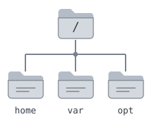

<h1 id="linux_lab">
  <a id="top"></a>
  <a href="assets/README.md#tux"></a>
  <picture>
    <source media="(prefers-color-scheme: dark)" srcset="assets/readme/linux-title-dark.svg">
    
  </picture>
</h1>

**Linux commands, Bash scripts, and the notes I come back to.**

This is the Linux and Bash side of my **Java/Spring Boot backend work**: working with files, running an application, reading its logs, and automating repeated tasks. I started it during my **Operating Systems lab at UBIT, University of Karachi**, and keep the useful notes and scripts here for revision.

<p>
  <a href="#current-work">Work so far</a> &nbsp;·&nbsp;
  <a href="#learning-map">Learning map</a> &nbsp;·&nbsp;
  <a href="#backend-practice">Practical work</a> &nbsp;·&nbsp;
  <a href="#working-in-this-lab">Use the lab</a>
</p>

<h2 id="current-work">
  <a id="lab-record"></a>
  <picture>
    <source media="(prefers-color-scheme: dark)" srcset="assets/readme/bash-dark.svg">
    
  </picture>
  Work so far
</h2>

The Linux notes reach permissions. The Bash notes cover the fundamentals; the exercises go further into conditions, loops, and arrays.

<table width="100%" border="0" cellspacing="0" style="border:0;border-collapse:collapse;font-family:system-ui,-apple-system,'Segoe UI',sans-serif;">
  <thead>
    <tr style="border:0;background:transparent;">
      <th align="left" width="24%" style="border:0;border-bottom:1px solid rgba(127,127,127,.35);padding:6px 12px;text-align:left;">Area</th>
      <th align="left" width="56%" style="border:0;border-bottom:1px solid rgba(127,127,127,.35);padding:6px 12px;text-align:left;">Work saved</th>
      <th align="left" width="20%" style="border:0;border-bottom:1px solid rgba(127,127,127,.35);padding:6px 12px;text-align:left;">Open it</th>
    </tr>
  </thead>
  <tbody>
    <tr style="border:0;background:transparent;">
      <td style="border:0;border-bottom:1px solid rgba(127,127,127,.35);padding:6px 12px;">Linux commands</td>
      <td style="border:0;border-bottom:1px solid rgba(127,127,127,.35);padding:6px 12px;">8 chapters, from paths to permissions</td>
      <td style="border:0;border-bottom:1px solid rgba(127,127,127,.35);padding:6px 12px;"><a href="learning/linux-commands/">Command notes</a></td>
    </tr>
    <tr style="border:0;background:transparent;">
      <td style="border:0;border-bottom:1px solid rgba(127,127,127,.35);padding:6px 12px;">Bash fundamentals</td>
      <td style="border:0;border-bottom:1px solid rgba(127,127,127,.35);padding:6px 12px;">4 chapters, through operators and exit statuses</td>
      <td style="border:0;border-bottom:1px solid rgba(127,127,127,.35);padding:6px 12px;"><a href="learning/bash-scripting/">Bash notes</a></td>
    </tr>
    <tr style="border:0;background:transparent;">
      <td style="border:0;border-bottom:1px solid rgba(127,127,127,.35);padding:6px 12px;">Bash practice</td>
      <td style="border:0;border-bottom:1px solid rgba(127,127,127,.35);padding:6px 12px;">12 scripts across basics, loops, and arrays</td>
      <td style="border:0;border-bottom:1px solid rgba(127,127,127,.35);padding:6px 12px;"><a href="practice/bash-scripting/">Practice folder</a></td>
    </tr>
  </tbody>
</table>

<h2 id="learning-map">
  <a id="what-im-learning"></a>
  <picture>
    <source media="(prefers-color-scheme: dark)" srcset="assets/readme/filesystem-dark.svg">
    
  </picture>
  Learning map
</h2>

The Linux and Bash topics I want for backend development. **Linked topics open recorded notes, exercises, or project code. Plain text is coverage still to add.** The links show where the work is, so the index can grow with the repository.

<details>
<summary><strong>01 · Files, paths, and permissions</strong></summary>

- [Navigation and paths](learning/linux-commands/01-navigation-and-paths/README.md) — `pwd`, `ls`, `cd`, absolute and relative paths.
- [Files and directories](learning/linux-commands/02-files-and-directories/README.md) — `mkdir`, `touch`, `file`, `stat`, `tree`.
- [Copying, moving, and deleting](learning/linux-commands/04-copying-moving-and-deleting/README.md) — source and destination paths, overwrites, and practice copies.
- [Permissions and ownership](learning/linux-commands/08-permissions-and-ownership/README.md) — `rwx`, `chmod`, `chown`, `chgrp`, `id`, `umask`.
- Users, groups, service accounts, and when `sudo` is needed.
- [Symbolic links and resolved paths](https://github.com/codewithmahad/deploylatch/blob/main/scripts/deploylatch.sh) — `ln -s` and `readlink` in the release-switching code.
- Archives and disk space — `tar`, `zip`, `unzip`, `df`, `du`.

Use these to organise projects, inspect application files, understand access errors, and manage artifacts.

</details>

<details>
<summary><strong>02 · Logs and text processing</strong></summary>

- [Reading files and following logs](learning/linux-commands/03-viewing-file-content/README.md) — `cat`, `less`, `head`, `tail`.
- [Searching text and finding files](learning/linux-commands/05-searching-and-finding/README.md) — `grep`, `find`, literal text, and patterns.
- [Text processing](learning/linux-commands/06-text-processing/README.md) — `wc`, `cut`, `sort`, `uniq`, `tr`, basic `sed` and `awk`.
- [Pipes and redirection](learning/linux-commands/07-redirection-and-pipes/README.md) — stdin, stdout, stderr, `|`, `>`, `>>`, `2>`, `tee`.
- Service logs and journal filters — `journalctl`.

Use these to find a startup error, follow a request through logs, and save or summarise useful output.

</details>

<details>
<summary><strong>03 · Processes and the Java runtime</strong></summary>

- Process inspection — `ps`, `pgrep`, `top`, process IDs, and resource use.
- Foreground and background jobs — `jobs`, `fg`, `bg`, `&`.
- Signals and graceful termination — `kill`, SIGTERM, and SIGKILL.
- Environment variables — `export`, `printenv`, `PATH`, `JAVA_HOME`, and inheritance.
- Packages and JDK selection — `apt`, `command -v`, `java -version`, `javac -version`.
- Running an executable JAR — `java -jar`, arguments, and process exit status.

Use these to prepare a Linux development environment, identify a Java process, and stop or investigate it.

</details>

<details>
<summary><strong>04 · Networking and remote access</strong></summary>

- HTTP requests — `curl`, headers, response bodies, status codes, timeouts, and failed requests.
- Listening ports and binding addresses — `ss`, localhost, and port conflicts.
- Basic connectivity and name resolution — `ping`, `hostname`, DNS, and hostnames.
- SSH access — keys, host verification, and `~/.ssh/config`.
- File transfer — `scp` and basic `rsync`.

Use these to test an API, distinguish a network problem from an application error, and work on a development VM.

</details>

<details>
<summary><strong>05 · Bash fundamentals</strong></summary>

- [Shell and script basics](learning/bash-scripting/01-shell-and-script-basics/README.md) — shebangs, execution order, working directories, and executable permissions.
- [Variables and expansion](learning/bash-scripting/02-variables-and-expansion/README.md) — quoting, `${name}`, `$(command)`, arithmetic, splitting, and globbing.
- [Input and output](learning/bash-scripting/03-input-and-output/README.md) — `IFS= read -r`, `printf`, fixed formats, and failed reads.
- [Operators and exit statuses](learning/bash-scripting/04-operators-and-expressions/README.md) — numeric and string tests, `$?`, `&&`, `||`.
- [Conditions and menus](practice/bash-scripting/03-loops/03-menu-calculator.sh) — `if`, `else`, `case`.
- [Loops](practice/bash-scripting/03-loops/) — `for`, `while`, `break`, `continue`.
- [Arrays](practice/bash-scripting/04-arrays/) — indexed and associative arrays, iteration, lookup, and `"${items[@]}"`.
- Arguments and defaults — `$1`, `$#`, `"$@"`, `shift`, `${name:-default}`, and usage messages.
- Functions and scope — parameters, `local`, return statuses, and reusable operations.

Use these to turn repeated terminal work into a small script that accepts inputs and produces predictable results.

</details>

<details>
<summary><strong>06 · Bash reliability and debugging</strong></summary>

- [Input validation](practice/bash-scripting/03-loops/01-validated-marks.sh) — numeric formats, decimal conversion, ranges, and retry loops.
- [Syntax checks and tracing](learning/bash-scripting/01-shell-and-script-basics/README.md#check-script-syntax) — `bash -n` and `bash -x`.
- [Static checks and regression tests](tests/check.sh) — ShellCheck and tests for normal input, invalid values, EOF, whitespace, and duplicates.
- Failure handling — explicit status checks, `exit`, stderr, `set -e`, `set -u`, `pipefail`, and their limits.
- Cleanup — `trap`, temporary files, and `mktemp`.
- Repeatable runs — checking dependencies, guarding file changes, and handling existing output.

Use these to understand a failed command and check a helper script before relying on it.

</details>

<details>
<summary><strong>07 · Practical backend workflows</strong></summary>

- Build and test a Java project with its Maven Wrapper.
- Run a Spring Boot JAR outside the IDE with the intended profile and environment.
- Test an API and write a health check with a clear HTTP success condition.
- Diagnose startup failures, occupied ports, and database connection errors.
- [Deploy and recover a Java service](https://github.com/codewithmahad/deploylatch/blob/main/scripts/deploylatch.sh) — versioned releases, health and version checks, and rollback.
- [Run Java under systemd](https://github.com/codewithmahad/deploylatch/blob/main/systemd/deploylatch-demo.service) — service configuration and restart behaviour.
- Write a build/test/run helper and reuse its build and test steps in CI.
- Archive sample configuration and logs, restore them elsewhere, and verify the contents.

Docker and Compose come with a later application exercise. Deep administration, advanced networking, Kubernetes, Terraform, and Ansible sit outside this lab's current scope.

</details>

<h2 id="backend-practice">
  <a id="learning-resources-and-practice"></a>
  <a href="https://github.com/codewithmahad/deploylatch">
    <picture>
      <source media="(prefers-color-scheme: dark)" srcset="assets/readme/deploylatch-dark.svg">
      
    </picture>
  </a>
  Practical work
</h2>

<a id="already-applied-deploylatch"></a>**Applied · [DeployLatch](https://github.com/codewithmahad/deploylatch)**

For my OS project, I built a Bash tool that deploys a Java service on Ubuntu and verifies its health and version. I tested a working update and recovery from a failed one. It made one distinction clear: a running process can still be unhealthy or running the wrong release.

[Deployment script](https://github.com/codewithmahad/deploylatch/blob/main/scripts/deploylatch.sh) · [Update and rollback demo](https://github.com/codewithmahad/deploylatch#deployment-demo)

The smaller exercises are saved here:

- **Reports:** [system report](practice/bash-scripting/01-basics/01-system-report.sh) · [session audit](practice/bash-scripting/01-basics/02-session-audit.sh).
- **Control flow:** [validated marks](practice/bash-scripting/03-loops/01-validated-marks.sh) · [menu calculator](practice/bash-scripting/03-loops/03-menu-calculator.sh).
- **Arrays:** [marks statistics](practice/bash-scripting/04-arrays/02-marks-statistics.sh) · [second-largest distinct value](practice/bash-scripting/04-arrays/03-second-largest.sh) · [name collection](practice/bash-scripting/04-arrays/05-name-collection.sh).

[Browse the practice scripts and their expected behaviour →](practice/bash-scripting/README.md)

<h2 id="working-in-this-lab">
  <a id="get-a-linux-terminal"></a>
  <a id="working-setup"></a>
  <a href="https://ubuntu.com/"></a>
  Using the lab
</h2>

**Ubuntu · Bash · Git · VS Code**

Learn a topic, try it, change the input, check the result, and commit the useful part. Short notes and corrections stay with the code so I can return to them later.

<details>
<summary><a id="lets-run-something"></a><strong>Setup, first run, and checks</strong></summary>

Ubuntu in WSL or a VM works for the exercises. The [setup guide](docs/GETTING_STARTED.md) covers the terminal, Git, and editor.

```bash
git clone https://github.com/codewithmahad/LINUX_LAB.git
cd LINUX_LAB
bash learning/bash-scripting/01-shell-and-script-basics/hello.sh
```

The greeting is `Hello From Bash`. Run the script checks from the repo root:

```bash
bash tests/check.sh
```

The checks need Bash, Python 3, and ShellCheck. On Ubuntu, install ShellCheck with `sudo apt install shellcheck` if needed. The same checks are configured for pushes and pull requests in [GitHub Actions](.github/workflows/bash-checks.yml).

Notes and chapter examples live in `learning/`; standalone exercises in `practice/`; checks in `tests/`. Existing chapters remain available for revision.

</details>

<details>
<summary><strong>References</strong></summary>

- **Bash and command options:** [GNU Bash manual](https://www.gnu.org/software/bash/manual/), local `man` pages, `command --help`, and Bash's `help` builtin.
- **Spring Boot:** [Running an application](https://docs.spring.io/spring-boot/reference/using/running-your-application.html) · [External configuration](https://docs.spring.io/spring-boot/reference/features/external-config.html).
- **Application command reference:** [Build, run, and inspect a separate Spring Boot project](practice/linux-commands/java-service-reference.md).
- **Builds and HTTP:** [Maven Wrapper](https://maven.apache.org/tools/wrapper/) · [curl manual](https://curl.se/docs/manpage.html).
- **Services and logs:** [systemctl](https://www.freedesktop.org/software/systemd/man/latest/systemctl.html) · [journalctl](https://www.freedesktop.org/software/systemd/man/latest/journalctl.html).

</details>

Other backend practice: [**Java Lab**](https://github.com/codewithmahad/JAVA_LAB) · [**SQL Lab**](https://github.com/codewithmahad/SQL_LAB) · [**My projects**](https://github.com/codewithmahad?tab=repositories)

Found a mistake? [Open an issue](https://github.com/codewithmahad/LINUX_LAB/issues) with the file, command, and result.

<p><sub>Shaikh Mahad · BSSE, UBIT &nbsp;·&nbsp; <a href="LICENSE">MIT License</a> &nbsp;·&nbsp; <a href="assets/README.md">Artwork credits</a> &nbsp;·&nbsp; <a href="#linux_lab">Back to top ↑</a></sub></p>
