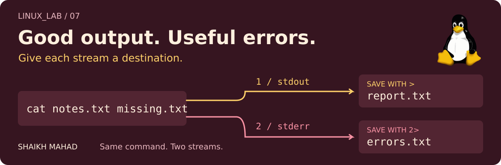

[LINUX_LAB](../../../README.md) / [Linux commands](../../../README.md#what-im-learning) / **07**

# Redirection and Pipes

<picture>
  <source media="(max-width: 620px)" srcset="../../../assets/lessons/redirection-and-pipes-mobile.svg">
  
</picture>

In the last chapter, I could turn a text file into a useful answer. Now I want to keep that answer, pass it to another command, or save the errors separately. The command can stay the same; I just change where its input and output go.

[Set up](#a-fresh-place-to-practise) · [Save output](#save-or-append) · [Handle errors](#errors-have-their-own-stream) · [Connect commands](#pipes-pass-output-to-another-command) · [Try it](#your-turn-save-a-review-report) · [Revision](#quick-revision)

## A fresh place to practise

Use Bash in a Linux terminal, including Ubuntu in WSL. The commands build on [Viewing File Content](../03-viewing-file-content/README.md), [Searching and Finding](../05-searching-and-finding/README.md), and [Text Processing](../06-text-processing/README.md).

From the repo root:

```bash
cd learning/linux-commands/07-redirection-and-pipes
mkdir -p ~/linux-lab-practice
practice_dir=$(mktemp -d ~/linux-lab-practice/streams.XXXXXX)
cp examples/notes.txt examples/session.txt "$practice_dir/"
cd "$practice_dir"
pwd
```

`mktemp -d` makes a new directory, replacing the six `X` characters with a random suffix. `$(...)` captures its path in `practice_dir`; `"$practice_dir"` uses that path as one argument. This is the same setup idea as [chapter 04](../04-copying-moving-and-deleting/README.md#a-fresh-place-to-practise).

**Stay in this new folder for the walkthrough.** If setup fails, fix that before continuing. Each new setup gives you fresh copies, and the practice folder stays available for revision.

| Supplied file | What we'll use it for |
| :--- | :--- |
| [notes.txt](examples/notes.txt) | Three reminders to read, copy, and redirect. |
| [session.txt](examples/session.txt) | A made-up six-line log with two `ERROR` lines and one `WARN` line. |

## Three streams, three numbers

| Number | Name | Usual connection in a terminal |
| :--- | :--- | :--- |
| `0` | **stdin**, standard input | What I type. |
| `1` | **stdout**, standard output | The command's normal output. |
| `2` | **stderr**, standard error | Diagnostics, usually shown in the same terminal. |

Those numbers identify open streams, also called *file descriptors*. Output and errors can look mixed together on screen while still being separate streams.

## Save or append

```bash
cat notes.txt > report.txt
cat report.txt
```

```text
Read the command.
Predict the output.
Try one change.
```

`>` sends stdout to a file. It creates the file if needed and **replaces its contents if it already exists**. `1>` means the same thing. Bash handles the redirection, so `cat` still just reads and prints text.

Use `>>` to keep the existing contents and add to the end:

```bash
echo "Next: permissions." >> report.txt
cat report.txt
```

`echo` prints that message with a newline. The report now has four lines. Running the append command again adds another line; it doesn't check for duplicates.

**Use a different output filename from the input.** `sort notes.txt > notes.txt` would empty the file before `sort` could read it. To keep a sorted copy, write to a new path such as `sorted-notes.txt`.

## Feed a file into stdin

```bash
wc -l < notes.txt
tr '[:lower:]' '[:upper:]' < notes.txt
```

The first prints `3`, without a filename. The second prints the three reminders in uppercase. `<` connects the file to stdin; neither command changes `notes.txt`. We met the `tr` character classes in [chapter 06](../06-text-processing/README.md).

## Errors have their own stream

There is deliberately no `missing.txt` in this practice folder:

```bash
cat notes.txt missing.txt > report.txt
```

The three reminders go into `report.txt`, but the missing-file error still appears in the terminal. `>` only redirects stdout.

Now give stderr its own destination too:

```bash
cat notes.txt missing.txt > report.txt 2> errors.txt
cat report.txt
cat errors.txt
```

The first command displays nothing: both streams go to files. Reading them shows the three reminders in the report and a diagnostic mentioning `missing.txt` in the error file. Its wording may vary by system.

Keep `2` attached to `>`: **`2> errors.txt`** redirects stream 2. `2>> errors.txt` appends errors instead of replacing the file. Redirecting an error message doesn't make the command successful.

<details>
<summary><strong>Put both streams together, or discard one</strong></summary>

```bash
cat notes.txt missing.txt > combined.txt 2>&1
cat combined.txt
```

`> combined.txt` points stdout at the file. Then `2>&1` points stderr at stdout's current destination. The `&1` refers to stream 1, not a file named `1`.

**Order matters.** `2>&1 > only-output.txt` would first point stderr at the original stdout, usually the terminal, then redirect only stdout to the file. Bash applies redirections from left to right. Bash's `&> combined.txt` is a shorter way to send both streams to that file.

`/dev/null` discards anything written to it:

```bash
cat missing.txt 2> /dev/null
```

This hides the known missing-file error. The command still fails. When debugging, I keep the diagnostic visible until I know what it means.

</details>

## Pipes pass output to another command

```bash
grep '^ERROR' session.txt | wc -l
```

This prints **`2`**. `grep` selects the lines beginning with `ERROR`; `|` connects its stdout to `wc`'s stdin, which counts those lines.

Read it left to right: **select the error lines → count them**. The commands can run at the same time as data flows through the pipe. No intermediate file is needed.

One distinction I keep handy: `>` expects a **file path**, while `|` connects to a **command**. A normal pipe carries stdout; stderr still goes to its existing destination.

## Tee: see it and save it

```bash
grep '^ERROR' session.txt | tee errors-only.txt
```

```text
ERROR backup folder missing
ERROR could not save report
```

`tee` copies stdin to both stdout and the named file. I see the two lines and keep a copy in `errors-only.txt`. It replaces that file by default; `tee -a` appends instead.

The pipeline can continue:

```bash
grep '^ERROR' session.txt | tee errors-only.txt | wc -l
```

Now the terminal shows `2`, because `tee` sends its stdout to `wc`. The saved file still contains the two error lines, not the count.

<details>
<summary><strong>A successful last command doesn't prove the whole pipe worked</strong></summary>

```bash
grep '^ERROR' missing.txt | wc -l
echo "$?"
```

You'll see a missing-file diagnostic and a count of `0`. With Bash's default pipeline settings, the next line also prints `0`: `$?` reports the final command's exit status, and `wc` successfully counted its empty input.

So I check the diagnostics too. Bash's `pipefail` option changes how a pipeline's status is chosen; that's useful when I start handling failures in scripts. The [Bash exit-status notes](../../bash-scripting/04-operators-and-expressions/README.md#exit-status) explain `$?`.

</details>

## Your turn: save a review report

Using `session.txt`:

1. Show its `ERROR` lines and save them in `review.txt` in the same command.
2. Count the saved lines through stdin and write only that count to `review-count.txt`.
3. Append `Reviewed these errors.` to a separate `progress.txt` file.

<details>
<summary><strong>Compare your commands</strong></summary>

```bash
grep '^ERROR' session.txt | tee review.txt
wc -l < review.txt > review-count.txt
echo "Reviewed these errors." >> progress.txt
cat review-count.txt
```

The report contains two error lines. The count file contains `2` with a newline, and the progress file keeps the new reminder. In the `wc` command, `<` supplies the input while `>` saves the output.

</details>

## Quick revision

| What I want | Syntax to remember |
| :--- | :--- |
| Replace a saved result | `command > file` |
| Add to an existing result | `command >> file` |
| Read through stdin | `command < file` |
| Keep diagnostics separately | `command 2> errors.txt` |
| Save output and errors together | `command > file 2>&1` |
| Pass output onwards | `command1 \| command2` |
| Keep a copy along the way | `command \| tee file` |

<details>
<summary><strong>References and artwork</strong></summary>

GNU Bash: [redirections](https://www.gnu.org/s/bash/manual/html_node/Redirections.html) and [pipelines](https://www.gnu.org/software/bash/manual/html_node/Pipelines.html). GNU Coreutils: [tee](https://www.gnu.org/software/coreutils/manual/html_node/tee-invocation.html). Offline: `man bash` and `man tee`. [Cover source and original Tux credit](../../../assets/README.md#lesson-covers).

</details>

[← 06: Text Processing](../06-text-processing/README.md) · [Learning map](../../../README.md#what-im-learning)

**[Next: 08, Permissions and Ownership →](../08-permissions-and-ownership/README.md)** Saving a file is one thing. Knowing who can read, change, or run it is next.
