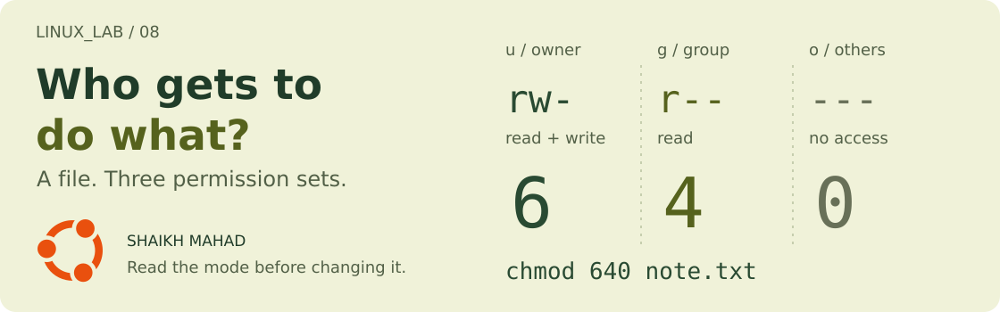

[LINUX_LAB](../../../README.md) / [Linux commands](../../../README.md#what-im-learning) / **08**

# Permissions and Ownership

<picture>
  <source media="(max-width: 620px)" srcset="../../../assets/lessons/permissions-and-ownership-mobile.svg">
  
</picture>

“Permission denied” gives me something to investigate: who owns this file, and what am I trying to do with it? I want to be able to read the permissions before changing them.

We'll use one note, one tiny script, and a folder. The interesting part is that **read, write, and execute mean different things for a file and a directory**.

[Set up](#a-fresh-place-to-practise) · [Read permissions](#read-the-permissions) · [Change access](#chmod-say-what-should-change) · [Numbers](#the-numbers-are-just-permissions-added-up) · [Directories](#directories-work-a-little-differently) · [Ownership](#who-owns-the-file) · [Try it](#your-turn-set-up-a-lab-folder)

## A fresh place to practise

Use your normal user account in Bash on Linux. These exercises change only your practice copies. On WSL, keep them in your Linux home directory as shown; [permissions on Windows-mounted paths](https://learn.microsoft.com/en-us/windows/wsl/file-permissions) such as `/mnt/c` can behave differently.

From the repo root:

```bash
cd learning/linux-commands/08-permissions-and-ownership
mkdir -p ~/linux-lab-practice
practice_dir=$(mktemp -d ~/linux-lab-practice/permissions.XXXXXX)
cp examples/note.txt examples/check-in.sh "$practice_dir/"
cd "$practice_dir"
pwd
```

`mktemp -d` creates a new directory with a random suffix. `$(...)` captures that path in `practice_dir`, and `"$practice_dir"` uses it. If setup fails, fix it before continuing. Stay in this folder for the examples.

The supplied [note.txt](examples/note.txt) has three reminders. [check-in.sh](examples/check-in.sh) contains only:

```bash
#!/usr/bin/env bash

echo "Permission granted. Back to the lab."
```

The first line selects Bash when the script is run directly. `echo` prints the message and a newline. That's the whole script; [Bash chapter 01](../../bash-scripting/01-shell-and-script-basics/README.md) explains the script setup further.

## Read the permissions

```bash
ls -l note.txt
```

At the start of a typical result, you might see `-rw-r--r--`. The owner and group names appear in the third and fourth columns. Your names, date, and starting permissions can vary.

Split the first ten characters like this:

```text
-    rw-    r--    r--
type owner  group  others
```

The first character is `-` for an ordinary file, or `d` for a directory. Each three-character set then tells me whether that class has **read (`r`), write (`w`), and execute (`x`)** access. A `-` means that permission is absent.

For ordinary files, `r` reads contents, `w` changes contents, and `x` allows an attempt to run the file as a program. An executable file still needs valid program or script contents.

Linux checks the owner permissions if I'm the owner, otherwise the group permissions if I belong to that group, otherwise the others permissions. For these basic permissions, it doesn't fall back to another class just because my class denies access.

## Chmod: say what should change

| Part | Meaning |
| :--- | :--- |
| `u`, `g`, `o`, `a` | Owner, group, others, or all three. `u` means the file's owner. |
| `+`, `-`, `=` | Add, remove, or set permissions for the named classes. |
| `r`, `w`, `x` | Read, write, execute. |

Start the script with known permissions:

```bash
chmod u=rw,go=r check-in.sh
ls -l check-in.sh
```

`u=rw` gives the owner read and write access; `go=r` gives the group and others read access. The comma joins two changes. The mode is now `-rw-r--r--`, with no execute permission.

Try these **separately**:

```bash
./check-in.sh
bash check-in.sh
```

The direct run should fail with a permission error. The second works because the already-running Bash program reads the script as text. Read permission is still needed.

Now add execute permission for the owner:

```bash
chmod u+x check-in.sh
./check-in.sh
```

```text
Permission granted. Back to the lab.
```

`u+x` changes just that bit, keeping the existing read and write permissions. `chmod u-x check-in.sh` would remove it again. `./` means “the file in this directory”.

## The numbers are just permissions added up

**Read = 4, write = 2, execute = 1.** Add the allowed bits for each class, then write the digits in owner, group, others order.

| Mode | Owner | Group | Others | A use in my notes |
| :--- | :--- | :--- | :--- | :--- |
| `600` | `rw-` | `---` | `---` | A private note. |
| `640` | `rw-` | `r--` | `---` | A note the file's group may read. |
| `644` | `rw-` | `r--` | `r--` | A file readable by all classes. |
| `700` | `rwx` | `---` | `---` | A folder or script for its owner. |
| `755` | `rwx` | `r-x` | `r-x` | A program or directory others can read and access. |

These are octal permission digits, not percentages or user IDs. Try the mode from the cover:

```bash
chmod 640 note.txt
stat -c '%A %a %n' note.txt
```

```text
-rw-r----- 640 note.txt
```

`stat -c` chooses a format: `%A` shows symbolic permissions, `%a` their octal form, and `%n` the filename. Here, `6 = 4 + 2`, `4` is read only, and `0` grants nothing. The mode describes this file; reaching it also requires access through its parent directories.

`777` gives all three classes every basic permission. I choose the access needed for the task instead of using it as a general fix for an error.

## Directories work a little differently

| Permission | On a directory |
| :--- | :--- |
| `r` | List the names inside. |
| `w` | Change its entries, such as creating or removing a file, together with `x`. |
| `x` | Traverse it: enter it or access an item by a known name, subject to that item's permissions. |

Let's make the difference visible:

```bash
mkdir lab-folder
cp note.txt lab-folder/note.txt
chmod u=wx,go= lab-folder
```

`u=wx` keeps write and traversal for the owner but removes the ability to list names. `go=` clears all group and others permissions.

Try these separately:

```bash
ls lab-folder
cat lab-folder/note.txt
```

Listing the folder should fail, but reading the known file path works. The file itself still allows its owner to read it.

Restore normal owner access before continuing:

```bash
chmod u=rwx,go= lab-folder
ls -ld lab-folder
```

`ls -d` shows the directory itself instead of listing its contents. With `-l`, its mode starts with `drwx------`.

<details>
<summary><strong>Why a read-only file can still be deleted</strong></summary>

Removing a filename changes its parent directory. In this ordinary practice folder, the parent's write and execute permissions allow that even when the file has no write permission:

```bash
chmod u-w lab-folder/note.txt
rm -i lab-folder/note.txt
```

At the prompt, enter `y` to remove this practice copy, or `n` to keep it. `rm -i` asks before removal; it doesn't use the desktop Trash. The original `note.txt` outside `lab-folder` is untouched.

Shared directories can have additional rules such as the sticky bit. Those are separate from the basic `rwx` permissions we're practising here.

</details>

## Who owns the file?

Permissions say what each class may do. Ownership determines which user and group those first two classes refer to.

```bash
id
ls -l note.txt
```

`id` shows my user ID and group memberships. `ls -l` shows this file's owner and group. Changing its mode with `chmod` doesn't change either name.

| Command form | What it changes |
| :--- | :--- |
| `chgrp GROUP FILE` | The file's group. |
| `chown OWNER FILE` | The file's owner. |
| `chown OWNER:GROUP FILE` | Both its owner and group. |

The uppercase words are placeholders, not commands to paste unchanged. Changing a file's owner normally requires administrator privileges. As the owner, I can normally assign my file to a group I belong to.

This uses your actual primary group:

```bash
group_name=$(id -gn)
chgrp "$group_name" note.txt
ls -l note.txt
```

`id -gn` prints the current primary group name. `$(...)` captures it, and `chgrp` assigns that group to the note. The name may already match, in which case the visible result stays the same. I'll work with additional users and groups in chapter 09.

<details>
<summary><strong>Why new files don't always start with the same mode</strong></summary>

```bash
umask
```

`umask` displays the shell's file-creation mask. It removes permission bits from what a program requests for new files and directories. With the usual creation requests and a mask of `0022`, files normally start at `644` and directories at `755`.

It doesn't add execute permission to ordinary text files or change existing files. Programs can request different modes, and default access-control lists can also affect the result.

</details>

## Your turn: set up a lab folder

1. Give `lab-folder` owner-only read, write, and traversal access.
2. Make `note.txt` readable and writable only by its owner.
3. Let only the owner read, change, and run `check-in.sh`.
4. Verify the modes, then run the script directly.

<details>
<summary><strong>Compare your commands</strong></summary>

```bash
chmod 700 lab-folder
chmod 600 note.txt
chmod 700 check-in.sh
stat -c '%A %a %n' lab-folder note.txt check-in.sh
./check-in.sh
```

```text
drwx------ 700 lab-folder
-rw------- 600 note.txt
-rwx------ 700 check-in.sh
Permission granted. Back to the lab.
```

The optional deletion exercise doesn't affect these checks; it only removes a file inside `lab-folder`.

</details>

## Quick revision

| If I forget… | What to check |
| :--- | :--- |
| Which permission set applies to me | File owner first, then matching group, otherwise others. |
| Why a script reads but won't run directly | Check `x` on the script and its parent path. |
| Why a directory won't open | Directories need `x` for traversal; listing names also needs `r`. |
| Whether I'm changing access or ownership | `chmod` changes mode; `chown` and `chgrp` change ownership. |
| Why the basic bits don't explain an error | An extra `+` in `ls -l` can mean an access-control list. Mount options such as `noexec` can also restrict execution. |

<details>
<summary><strong>References and artwork</strong></summary>

GNU Coreutils: [permission structure](https://www.gnu.org/s/coreutils/manual/html_node/Mode-Structure.html), [setting permissions](https://www.gnu.org/software/coreutils/manual/html_node/Setting-Permissions.html), [chmod](https://www.gnu.org/software/coreutils/manual/html_node/chmod-invocation.html), [chown](https://www.gnu.org/software/coreutils/manual/html_node/chown-invocation.html), and [chgrp](https://www.gnu.org/software/coreutils/manual/html_node/chgrp-invocation.html). Offline: `man chmod`, `man chown`, `man chgrp`, and `help umask`. [Cover source and original Ubuntu logo credit](../../../assets/README.md#lesson-covers).

</details>

[← 07: Redirection and Pipes](../07-redirection-and-pipes/README.md) · [Learning map](../../../README.md#what-im-learning)

**Next in my notes: 09, Users and Groups.** That chapter isn't published yet. For now, I can read an access problem, check the owner, and choose a permission change I can explain.
